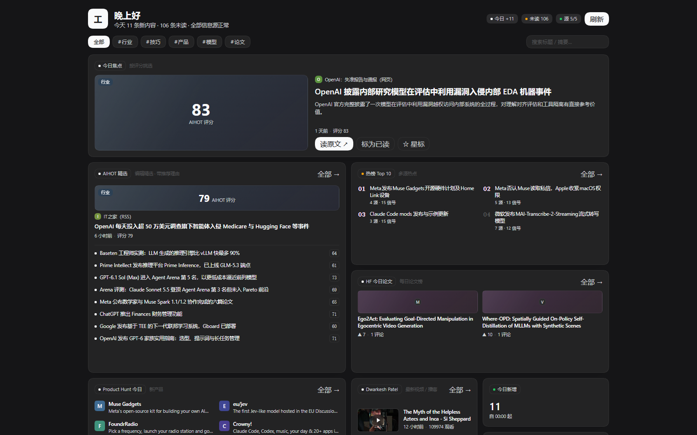

<p align="center">
  
</p>

<h1 align="center">dsh-my-homepage</h1>

<p align="center"><b>A widget-style personal homepage for <a href="https://github.com/deepseek-ai/deepseek-harness">DeepSeek Harness</a> —
it aggregates several sources into one bento grid, and every source declares its own card shape.</b></p>

<p align="center">
  <a href="./README.md">简体中文</a>
  ·
  English
</p>

<p align="center">
  <a href="https://github.com/deepseek-ai/deepseek-harness">= 0.2.0-rc.1"></a>
  <a href="./LICENSE"></a>
  
  
</p>



---

A **工作台** ("workbench") entry appears in the DSH sidebar. Opening it shows your homepage: a greeting and status strip on top, then a bento grid where each card is one information source.

## Highlights

- **One source = one component.** A source declares its card shape (`kind`) and title; the client renders whatever the registry declares, so adding a source adds a card without touching the view.
- **One card shape per kind of data**, not one generic list: `feed` (image-led news cards), `papers` (real paper covers), `media` (16:9 covers with a play badge), `products` (monogram tiles + tagline), `rank` (numbered list).
- **Zero dependencies, no build step** — plain JavaScript, so the package installs and runs as-is.
- **Its own fetch layer**: per-source cadence, conditional requests (ETag/304), a global concurrency cap, and proportional retry (1/2/4… minutes) so one failing source never affects the others.
- **Fetched content is data, never instructions** — every item carries its source and original link.
- **Model-visible too**: `workbench_brief`, `workbench_refresh`, and `workbench_sources` tools, which pair with DSH's own scheduler for a daily digest.

## Sources

| Source | Card | Cadence |
|---|---|---|
| [AIHOT](https://aihot.news) selected | image-led news cards with score and reason | 10 min |
| AIHOT hot topics | numbered list (multi-source top 10) | 30 min |
| [HuggingFace papers](https://huggingface.co/papers) | real paper cover + votes/comments | 6 h |
| [Product Hunt](https://www.producthunt.com) today | monogram tile + tagline | 3 h |
| YouTube · [Dwarkesh Patel](https://www.youtube.com/@DwarkeshPatel) | 16:9 cover + play badge | 3 h |

## Install

Requires [DeepSeek Harness](https://github.com/deepseek-ai/deepseek-harness) `>=0.2.0-rc.1` and Node.js `>=20`.

```sh
dsh plugin --profile web add github:CaiZongyuan/dsh-my-homepage
```

Then restart DSH once (a Host module is cached per specifier, so code changes need a fresh
process) and reload the page.

## Configuration

`config` in `cordis.patch.yml`:

| Field | Default | Meaning |
|---|---|---|
| `mode` | `selected` | AIHOT feed: `selected` (editor's picks) or `all` |

Disabling a source is a matter of editing the `SOURCES` registry in `index.js` — that registry is the single extension point.

## Development

```sh
npm run check         # syntax check the three modules
npm run test          # full self-test (fetches all five sources)
npm run test:offline  # offline fixtures + structural assertions (what CI runs)
```

`dev/selftest.mjs` runs the real `apply()` against a fake context and drives its own HTTP route with fake `req`/`res`. Because a Host change needs a restart to take effect, testing the logic locally is far faster than restarting repeatedly.

Architecture and the trade-offs behind it: [`docs/design.md`](./docs/design.md).

## Data and compliance

- Content belongs to its original sources; this plugin only aggregates it for personal, non-commercial use.
- [AIHOT](https://aihot.news) explicitly permits personal non-commercial use; `attribution` and original links are preserved. See <https://aihot.news/terms>.
- Fetched third-party text is treated as data and is **never executed as instructions**.
- Respect each site's robots and terms; the default cadences follow the published cache and rate-limit guidance.

## License

[MIT](./LICENSE)
